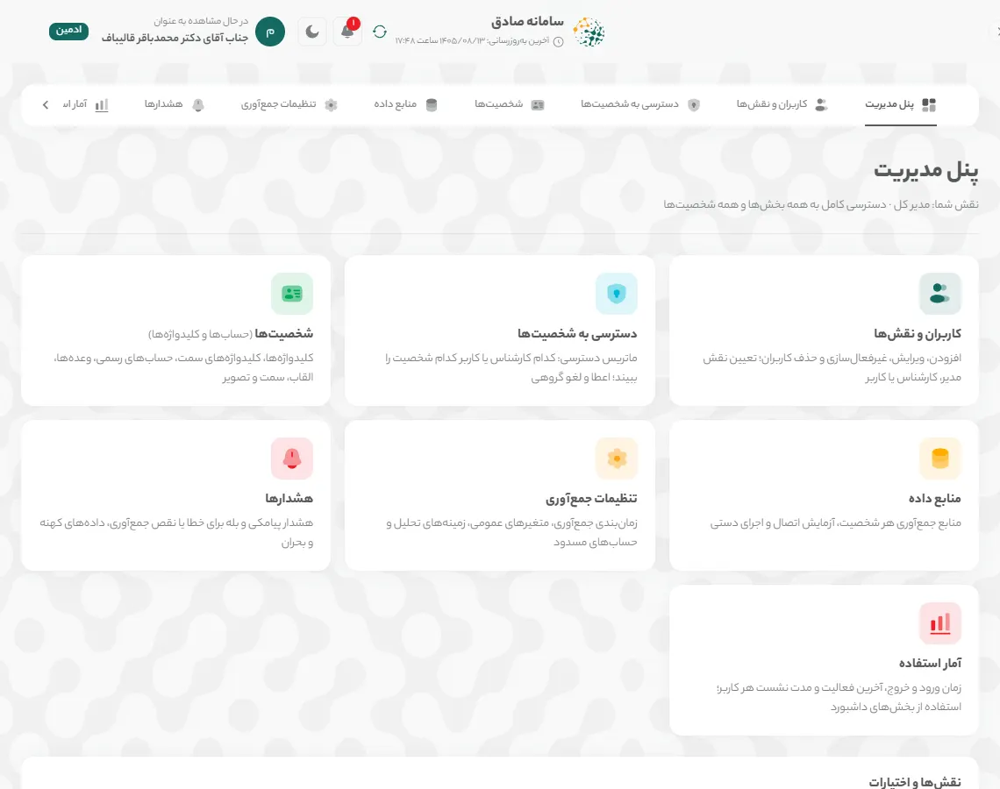
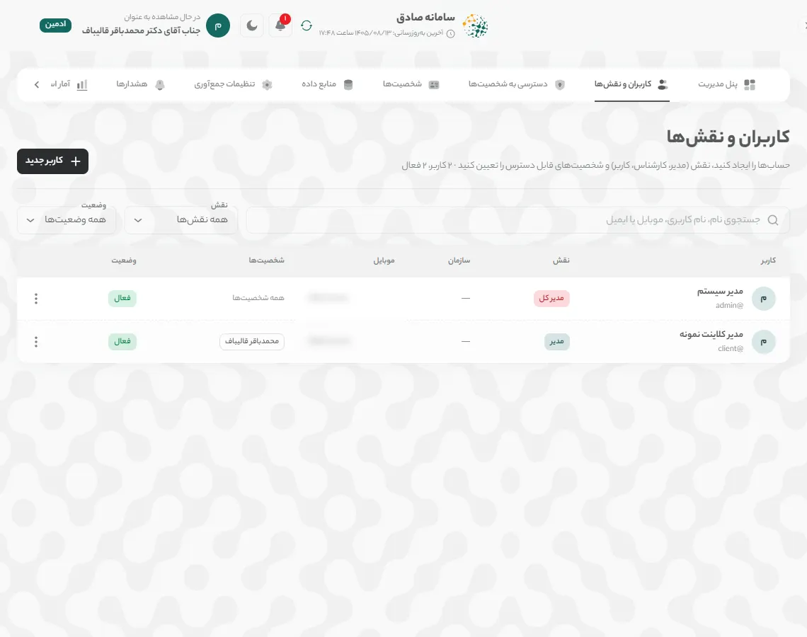
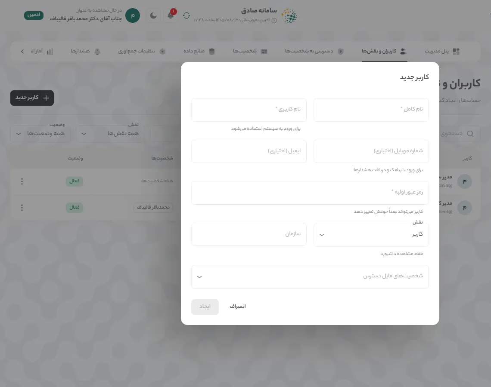
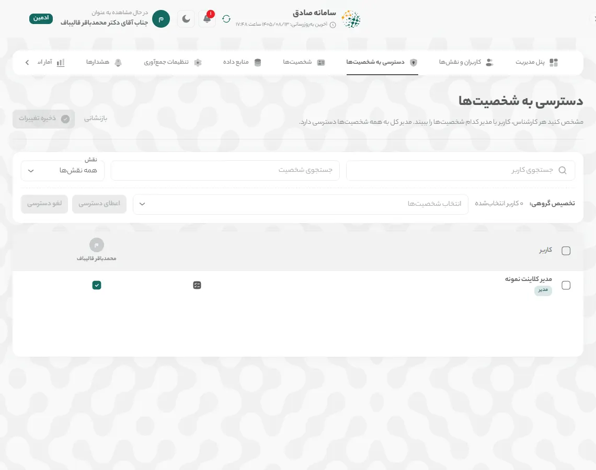
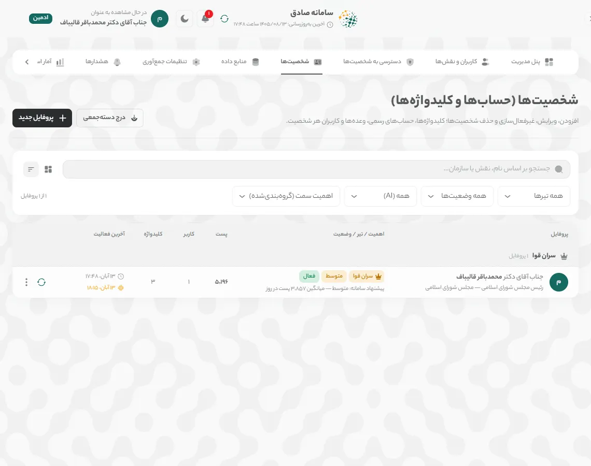
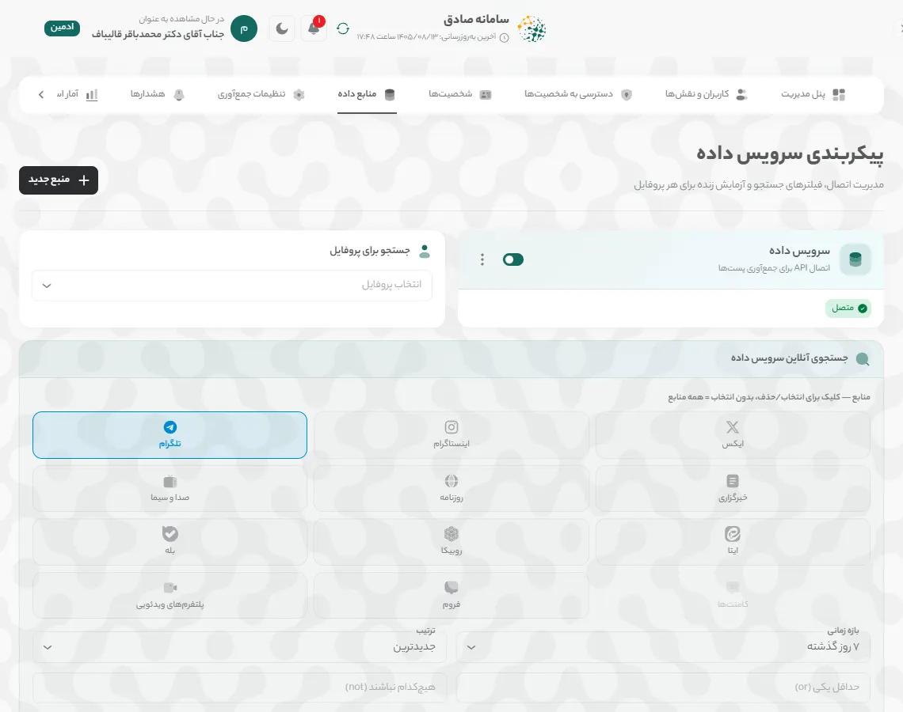
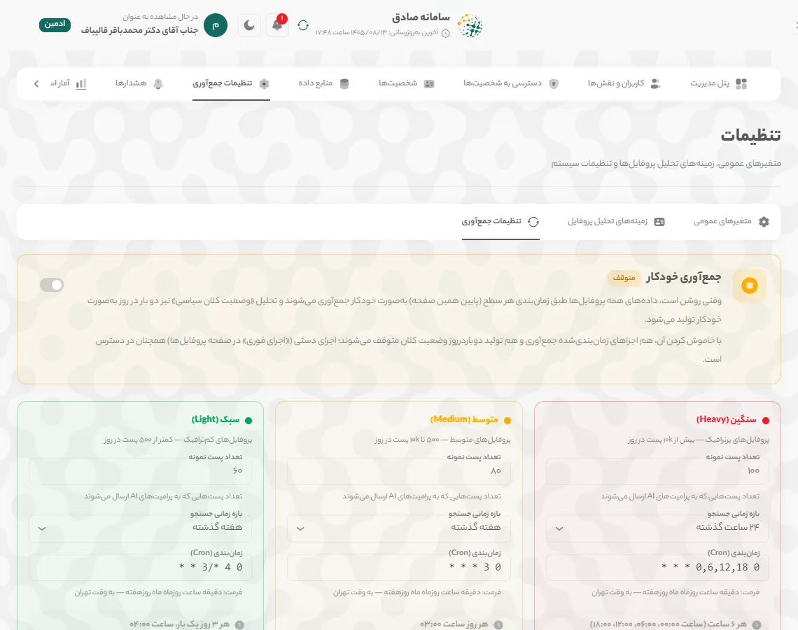
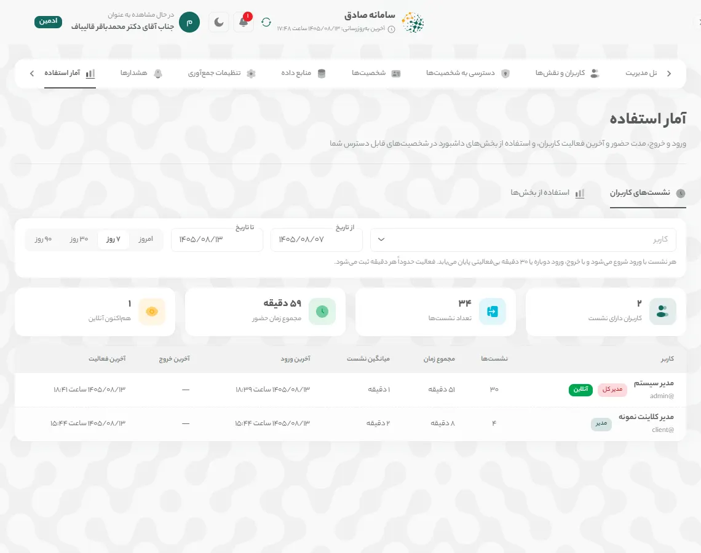
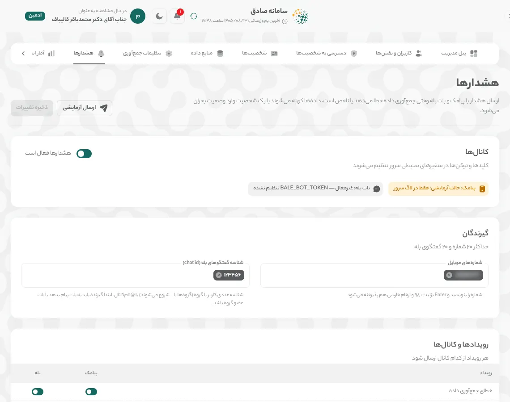

# سامانه صادق — راهنمای مدیر

> مدیر (مرکز پایش و فراداده) پنل مدیریت جامع را در اختیار دارد: کاربران و نقش‌ها، دسترسی به شخصیت‌ها، شخصیت‌ها، منابع داده و جمع‌آوری، آمار استفاده و هشدارها. نقش «مدیر کل» همه این بخش‌ها را دارد و نقش «مدیر» بخش‌های مربوط به سازمان خود را.

این راهنما همان محتوای بخش «راهنما» در خود سامانه است. نسخه تصویری و تعاملی آن را در منوی کنار صفحه، بخش «راهنما» ببینید.

## چه کارهایی می‌توانید بکنید

- ساخت، ویرایش، غیرفعال‌سازی و حذف کاربران و تعیین نقش آن‌ها
- تعیین دسترسی هر کاربر به شخصیت‌ها در ماتریس دسترسی
- ویرایش شخصیت‌ها؛ افزودن و حذف شخصیت (مدیر کل)
- تنظیم منابع داده، زمان‌بندی جمع‌آوری و حساب‌های مسدود (مدیر کل)
- دیدن آمار استفاده و نشست‌های کاربران
- تنظیم هشدار پیامکی و بله (مدیر کل)

همه آنچه در «راهنمای کارشناس» آمده برای این نقش هم کاربرد دارد: [راهنمای کارشناس](expert-guide.md)

## فهرست مطالب

۱. [پنل مدیریت](#admin-panel)
۲. [کاربران و نقش‌ها](#users)
۳. [ماتریس دسترسی به شخصیت‌ها](#access)
۴. [شخصیت‌ها](#profiles)
۵. [منابع داده و تنظیمات جمع‌آوری](#data-sources)
۶. [آمار استفاده](#usage)
۷. [هشدارها](#alerts)
- [واژه‌نامه کارت‌ها](#glossary)
- [پرسش‌های پرتکرار](#faq)

## ۱. پنل مدیریت

همه کارهای مدیریتی در «پنل مدیریت» است. هر نقش فقط بخش‌هایی را می‌بیند که اجازه‌اش را دارد.

### گام ۱: نمای کلی

**«پنل مدیریت»** را از منوی کنار صفحه باز کنید. کارت هر بخش آن را باز می‌کند و نوار بالای پنل بین بخش‌ها جابه‌جا می‌شود. جدول **«نقش‌ها و اختیارات»** اختیارات چهار نقش را نشان می‌دهد.

> **نکته:** **«مدیر»** کاربران و شخصیت‌های سازمان خود را مدیریت می‌کند و فعالیت مدیر کل را نمی‌بیند. **«منابع داده»**، **«تنظیمات جمع‌آوری»**، **«هشدارها»** و افزودن یا حذف شخصیت فقط در اختیار **«مدیر کل»** است.

*تصویر: «پنل مدیریت»: نمای کلی*

## ۲. کاربران و نقش‌ها

حساب بسازید، نقش (مدیر، کارشناس یا کاربر) و شخصیت‌های قابل دسترس را تعیین کنید.

### گام ۱: فهرست کاربران

در **«کاربران و نقش‌ها»** با **«جستجوی نام، نام کاربری، موبایل یا ایمیل»** و فیلترهای **«نقش»** و **«وضعیت»** کاربران را پیدا کنید. منوی ⋮ هر ردیف **«ویرایش»**، **«تغییر رمز عبور»**، **«غیرفعال‌سازی»** / **«فعال‌سازی»** و **«حذف کاربر»** را دارد.

*تصویر: صفحه «کاربران و نقش‌ها»*

### گام ۲: کاربر جدید

**«کاربر جدید»** را بزنید و **«نام کامل»**، **«نام کاربری»**، **«رمز عبور اولیه»** و **«نقش»** را وارد کنید. **«شماره موبایل (اختیاری)»** برای ورود با پیامک و دریافت هشدارها لازم است. در **«شخصیت‌های قابل دسترس»** شخصیت‌هایی را که این کاربر می‌بیند انتخاب کنید و **«ایجاد»** را بزنید.

*تصویر: پنجره «کاربر جدید»*

### گام ۳: غیرفعال‌سازی یا حذف

برای بستن موقت ورود، **«غیرفعال‌سازی»** را بزنید؛ هر زمان بخواهید دوباره فعالش کنید. **«حذف کاربر»** حساب و دسترسی‌هایش را برای همیشه پاک می‌کند و بازگشت‌پذیر نیست.

## ۳. ماتریس دسترسی به شخصیت‌ها

مشخص کنید هر کارشناس، کاربر یا مدیر کدام شخصیت‌ها را ببیند. مدیر کل به همه شخصیت‌ها دسترسی دارد.

### گام ۱: تغییر تکی

در **«دسترسی به شخصیت‌ها»** هر ردیف یک کاربر و هر ستون یک شخصیت است. با زدن هر خانه دسترسی را بدهید یا بردارید؛ خانه‌های تغییرکرده رنگی می‌شوند. با **«جستجوی کاربر»**، **«جستجوی شخصیت»** و **«نقش»** جدول را کوچک کنید.

*تصویر: صفحه «دسترسی به شخصیت‌ها»*

### گام ۲: تخصیص گروهی

کاربران را با چک‌باکس کنار نامشان انتخاب کنید، در **«تخصیص گروهی:»** از **«انتخاب شخصیت‌ها»** شخصیت‌ها را برگزینید و **«اعطای دسترسی»** یا **«لغو دسترسی»** را بزنید.

### گام ۳: ثبت تغییرات

تا **«ذخیره تغییرات»** را نزنید و در پنجره تأیید **«ثبت»** را انتخاب نکنید، چیزی ذخیره نمی‌شود. **«بازنشانی»** همه تغییرات ذخیره‌نشده را برمی‌گرداند.

> **نکته:** سامانه اجازه نمی‌دهد آخرین شخصیت یک کاربر را از او بگیرید؛ برای بستن ورود، کاربر را غیرفعال کنید.

## ۴. شخصیت‌ها

شخصیت‌های تحت رصد را با کلیدواژه‌ها، حساب‌های رسمی، وعده‌ها و کاربرانشان مدیریت کنید.

### گام ۱: فهرست شخصیت‌ها

مدیر کل در **«شخصیت‌ها (حساب‌ها و کلیدواژه‌ها)»** همه شخصیت‌ها را با سطح، وضعیت، تعداد پست و آخرین فعالیت می‌بیند و می‌تواند بین نمای **«کارت»** و **«جدول»** جابه‌جا شود. منوی ⋮ هر شخصیت **«ویرایش»**، **«اجرای فوری»**، **«دانلود داده‌ها»**، **«آمار استفاده»**، **«غیرفعال‌سازی»** و **«حذف دائمی»** را دارد.

*تصویر: صفحه «شخصیت‌ها» از دید مدیر کل*

### گام ۲: شخصیت جدید

با **«پروفایل جدید»** شخصیت تازه بسازید یا با **«درج دسته‌جمعی»** چند شخصیت را از فایل اضافه کنید. در پنجره ویرایش، علاوه بر بخش‌هایی که کارشناس می‌بیند، **«اهمیت سمت (ترتیب در فهرست‌ها)»**، **«سطح پروفایل (Tier)»**، **«وزن منابع داده»**، **«کاربران دارای دسترسی»** و **«مدیریت نمایش بخش‌ها»** در دسترس مدیر کل است.

### گام ۳: مدیر سازمان

**«مدیر»** در همین صفحه فقط شخصیت‌های خود را می‌بیند و مانند کارشناس با **«ویرایش اطلاعات»** آن‌ها را ویرایش می‌کند (راهنمای کارشناس را ببینید).

## ۵. منابع داده و تنظیمات جمع‌آوری

فقط مدیر کل: منبع جمع‌آوری هر شخصیت، زمان‌بندی جمع‌آوری و حساب‌های مسدود را تنظیم کنید.

### گام ۱: منابع داده

در **«منابع داده»** (صفحه **«پیکربندی سرویس داده»**) منبع هر شخصیت را با **«منبع جدید»** تعریف کنید و با کلید کنار هر منبع آن را فعال یا غیرفعال کنید. در **«جستجوی آنلاین سرویس داده»** یک پروفایل و سکو را انتخاب کنید تا اتصال و نتیجه جستجو را زنده آزمایش کنید.

*تصویر: صفحه «پیکربندی سرویس داده»*

### گام ۲: تنظیمات جمع‌آوری

در **«تنظیمات جمع‌آوری»** با کلید **«جمع‌آوری خودکار»** زمان‌بندی را روشن یا متوقف کنید. برای هر سطح (**«سنگین»**، **«متوسط»**، **«سبک»**) **«تعداد پست نمونه»**، **«بازه زمانی جستجو»** و زمان‌بندی را تنظیم و **«ذخیره تنظیمات»** را بزنید. همه زمان‌ها به وقت تهران است و تغییرات بدون راه‌اندازی دوباره اعمال می‌شود.

*تصویر: برگه «تنظیمات جمع‌آوری»*

### گام ۳: حساب‌های مسدود

در کارت **«حساب‌های مسدود»** (پایین همان صفحه) نام کاربری حساب‌های تبلیغاتی یا بی‌ربط را اضافه کنید و **«ذخیره فهرست»** را بزنید؛ پست‌های آن‌ها در تحلیل‌ها حساب نمی‌شود.

### گام ۴: جمع‌آوری دستی

مدیر و مدیر کل با دکمه **«جمع‌آوری داده‌ها»** در نوار بالای صفحه می‌توانند جمع‌آوری شخصیت انتخاب‌شده را فوراً اجرا کنند و پیشرفت آن را ببینند. پنجره را می‌توان بست؛ جمع‌آوری در پس‌زمینه ادامه دارد.

## ۶. آمار استفاده

ورود و خروج، مدت حضور و آخرین فعالیت هر کاربر، و استفاده از بخش‌های داشبورد.

### گام ۱: نشست‌های کاربران

در **«آمار استفاده»** برگه **«نشست‌های کاربران»** برای هر کاربر زمان **«ورود»**، **«آخرین فعالیت»**، **«مدت»** و **«پایان»** را نشان می‌دهد. هر نشست با **«خروج»**، **«ورود دوباره»** یا ۳۰ دقیقه بی‌فعالیتی پایان می‌یابد؛ نشست باز با **«در جریان»** و کاربر حاضر با **«آنلاین»** مشخص است. بازه را با **«امروز»**، **«۷ روز»**، **«۳۰ روز»**، **«۹۰ روز»** یا تاریخ دلخواه و کاربر را با فیلتر انتخاب کنید.

*تصویر: صفحه «آمار استفاده»*

### گام ۲: استفاده از بخش‌ها

برگه **«استفاده از بخش‌ها»** **«رتبه‌بندی پروفایل‌ها»** و **«پرکاربردترین بخش‌ها»** را بر اساس تعداد بازدید نشان می‌دهد. برای دیدن جزئیات هر کاربر روی پروفایل بزنید.

> **نکته:** مدیر فقط کاربران شخصیت‌های خود را می‌بیند؛ نشست‌های مدیر کل به او نمایش داده نمی‌شود.

## ۷. هشدارها

فقط مدیر کل: وقتی جمع‌آوری خطا می‌دهد یا ناقص است، داده‌ها کهنه می‌شوند یا شخصیتی وارد بحران می‌شود، پیامک یا پیام بله ارسال شود.

### گام ۱: کانال‌ها و گیرندگان

در **«هشدارها»** کلید **«هشدارها فعال است»** را روشن کنید. در **«گیرندگان»** **«شماره‌های موبایل»** و شناسه گفتگوهای بله را بنویسید و Enter بزنید (حداکثر ۲۰ شماره و ۲۰ گفتگوی بله).

*تصویر: صفحه «هشدارها»*

### گام ۲: رویدادها و آستانه‌ها

در **«رویدادها و کانال‌ها»** برای هر رویداد (**«خطای جمع‌آوری داده»**، **«جمع‌آوری ناقص (بیشتر منابع خالی)»**، **«داده‌ها به‌روز نیست»**، **«ورود پروفایل به وضعیت بحران»**) پیامک و بله را جدا روشن کنید. در **«آستانه‌ها»** کهنگی داده، **«حداقل سطح بحران»** و حد جمع‌آوری ناقص را تعیین کنید.

### گام ۳: ذخیره و آزمایش

**«ذخیره تغییرات»** را بزنید، سپس با **«ارسال آزمایشی»** یک پیام آزمایشی به گیرنده‌های ذخیره‌شده بفرستید. جدول **«آخرین هشدارها»** زمان، شخصیت و وضعیت ارسال هر هشدار را نشان می‌دهد.

## واژه‌نامه کارت‌ها

هر کارت داشبورد در یک جمله. توضیح کامل، نحوه محاسبه و منبع داده هر کارت در نماد (i) کنار عنوان آن است.

### صفحه «داشبورد»

- **شاخص سلامت اعتبار:** تراز کلی احساسات کاربران نسبت به این شخصیت، روی مقیاس ۰ تا ۱۰۰.
- **خلاصه هوش مصنوعی:** خلاصه متنی وضعیت فضای مجازی درباره این شخصیت در سه بند کوتاه: وضعیت کلی احساسات، موضوعات و پلتفرم‌های غالب، و مهم‌ترین هشدار یا فرصت.
- **رادار بحران:** پنج نشانه زودهنگام بحران رسانه‌ای: احساسات منفی، سرعت انتشار، بازتاب صفحات رسمی، تأثیرگذاری و تعاملات.
- **روند احساسات:** تعداد پست‌های مثبت، خنثی و منفی در هر روز؛ در نمای ۲۴ ساعت، در هر ساعت.
- **طیف سیاسی:** پست‌های هر جناح سیاسی درباره این شخصیت و اینکه چه سهمی از آن‌ها مثبت، خنثی یا منفی است.
- **هشتگ‌ها و موضوعات داغ:** موضوعات و هشتگ‌هایی که بیشترین تکرار را در پست‌های مرتبط داشته‌اند.
- **پربازدیدترین محتواها:** پست‌هایی درباره این شخصیت که بیشترین بازدید را داشته‌اند.
- **منابع داده:** تعداد پست‌های مرتبط با این شخصیت در هر پلتفرم.

### صفحه «تحلیل»

- **وضعیت کلان کشور:** مهم‌ترین رویدادهای امروز و دیروز کشور در چهار حوزه: فرهنگی و اجتماعی، سیاسی و دیپلماتیک، امنیتی و نظامی، اقتصادی و معیشتی؛ به‌همراه رویدادهای مرتبط با خود شخصیت.
- **چشم‌انداز عمومی:** چشم‌انداز عمومی: سهم هر حالت احساسی (امید، نگرانی، اطمینان و …) در پست‌های مرتبط.
- **ابر واژگان:** کلیدواژه‌های پرتکرار در گفتگوها درباره این شخصیت؛ هرچه واژه بزرگ‌تر، پرتکرارتر.
- **حساب‌های ربات و انسانی:** چه سهمی از حساب‌هایی که درباره این شخصیت نوشته‌اند احتمالاً ربات یا مشکوک‌اند، و مشکوک‌ترین حساب‌ها کدام‌اند.
- **تحلیل شکاف روایت:** چه سهمی از بحث مردم به روایت‌هایی می‌پردازد که شخصیت در صفحات رسمی‌اش مطرح می‌کند، و مردم خارج از این روایت‌ها درباره چه موضوعاتی می‌نویسند.

### صفحه «رسانه»

- **صفحات رسمی:** کانال‌ها و صفحات رسمی این شخصیت که در سامانه پایش می‌شوند.
- **رصد وعده‌ها:** وعده‌های ثبت‌شده این شخصیت، سمت و دوره مسئولیتی که وعده در آن داده شده، و واکنش مردم به هر کدام.
- **تحلیل محتوای منتشرشده:** حجم، بازدید، لایک و بازنشر محتوای منتشرشده در صفحات رسمی، هفته به هفته.
- **تایم‌لاین یکپارچه:** آخرین پست‌های منتشرشده در صفحات رسمی، به ترتیب زمان.

### صفحه «پست‌ها»

- **خلاصه پلتفرم‌ها:** تعداد کل پست‌هایی که در هر پلتفرم درباره این شخصیت منتشر شده است.
- **نقشه تأثیرگذاران:** حساب‌هایی که بیشترین بازدید را در گفتگو درباره این شخصیت داشته‌اند و موضعشان.
- **پربازدیدترین پست‌ها:** پست‌هایی با بیشترین تعداد بازدید.
- **پربحث‌ترین پست‌ها:** پست‌هایی که بیشترین بحث و نظر را برانگیخته‌اند.
- **پرتکرارترین پست‌ها:** پست‌هایی که بیشتر از بقیه بازنشر یا فوروارد شده‌اند.

### صفحه «پیشنهادها»

- **پیشنهادهای امروز:** پیشنهادهای عملیاتی برای واکنش رسانه‌ای.
- **شبیه‌ساز سناریو:** شبیه‌ساز سناریو: یک اتفاق فرضی بنویسید تا واکنش احتمالی فضای مجازی پیش‌بینی شود.

## پرسش‌های پرتکرار

**فرق «مدیر» و «مدیر کل» چیست؟**

**«مدیر کل»** به همه بخش‌ها و همه شخصیت‌ها دسترسی دارد. **«مدیر»** فقط کاربران، دسترسی‌ها و آمار استفاده شخصیت‌های سازمان خود را مدیریت می‌کند و منابع داده، تنظیمات جمع‌آوری و هشدارها را نمی‌بیند.

**کاربری که دیگر نباید وارد شود را حذف کنم یا غیرفعال؟**

غیرفعال کنید. سوابق نشست‌ها و دسترسی‌ها می‌ماند و هر زمان بخواهید دوباره فعال می‌شود. حذف بازگشت‌پذیر نیست.

**چرا هشدار پیامکی ارسال نمی‌شود؟**

بررسی کنید **«هشدارها فعال است»** روشن باشد، گیرنده‌ها ذخیره شده باشند و برای آن رویداد کانال پیامک روشن باشد. وضعیت سرویس پیامک و بات بله زیر **«کانال‌ها»** نمایش داده می‌شود؛ تنظیم کلیدهای آن‌ها با تیم فنی است.

**چطور ببینم چه کسی چه زمانی وارد شده است؟**

در **«آمار استفاده»** برگه **«نشست‌های کاربران»** را باز کنید و کاربر و بازه را انتخاب کنید.

**چرا نمی‌توانم نام یا سازمان شخصیت را تغییر دهم؟**

نام، سازمان، سطح و اولویت شخصیت و افزودن یا حذف شخصیت فقط در اختیار مدیر کل است. اگر تغییری لازم است، به مدیر کل اطلاع دهید.

---

© حقوق مادی و معنوی سامانه صادق و این راهنما محفوظ است. هرگونه تکثیر، انتشار یا استفاده تجاری از محتوا و تصاویر این راهنما بدون مجوز کتبی، مطابق «قانون حمایت از حقوق مؤلفان و مصنفان و هنرمندان» ممنوع و پیگرد قانونی دارد.

© ۱۴۰۵ سامانه صادق، تمامی حقوق محفوظ است.

