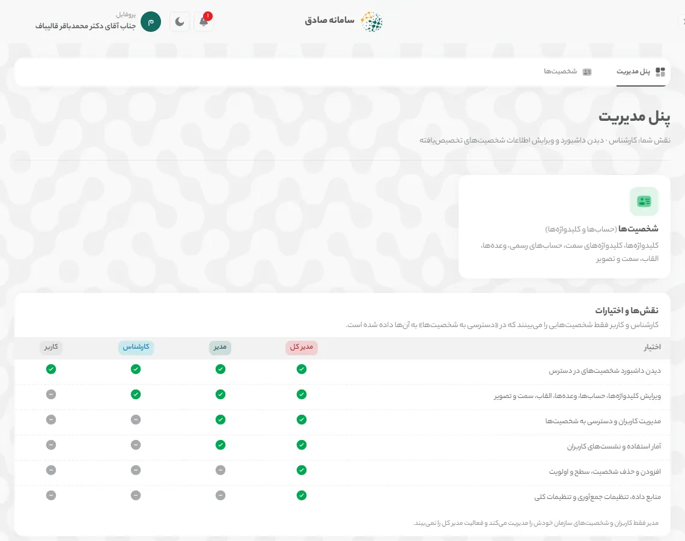
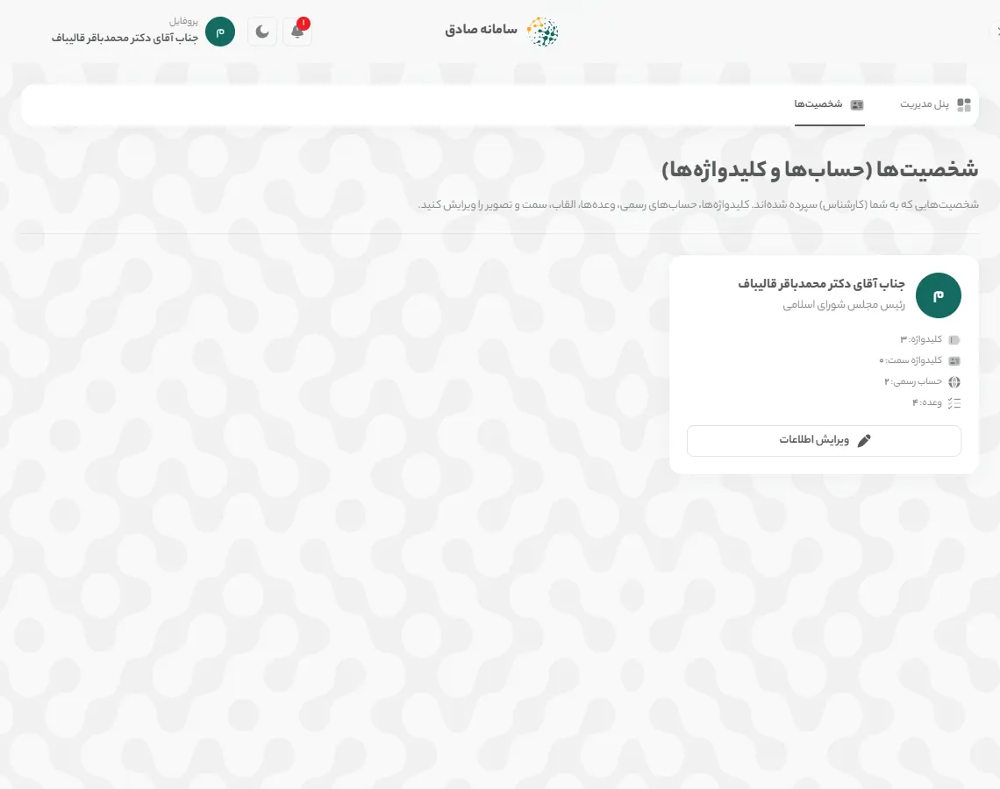
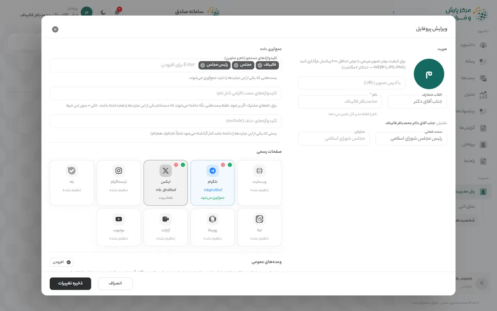
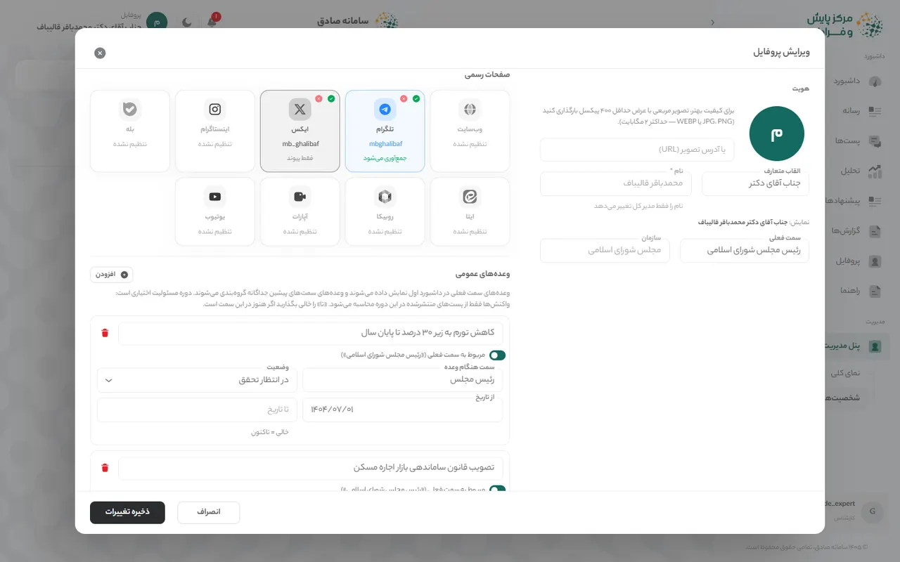
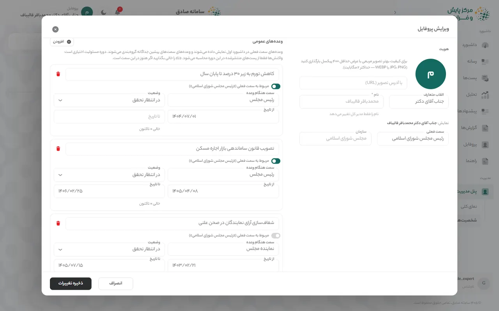

# سامانه صادق — راهنمای کارشناس

> کارشناس با مجوز مدیر، اطلاعات شخصیت‌هایی را که به او سپرده شده به‌روز نگه می‌دارد و همه امکانات کاربر را هم دارد.

این راهنما همان محتوای بخش «راهنما» در خود سامانه است. نسخه تصویری و تعاملی آن را در منوی کنار صفحه، بخش «راهنما» ببینید.

## چه کارهایی می‌توانید بکنید

- همه کارهای کاربر (ورود، داشبورد، فیلترها، گزارش)
- ویرایش القاب، سمت فعلی و تصویر شخصیت‌های سپرده‌شده
- ویرایش کلیدواژه‌های جستجو، کلیدواژه‌های سمت و کلیدواژه‌های حذف
- افزودن و ویرایش صفحات رسمی در سکوها
- ثبت وعده‌ها با سمت و دوره مسئولیت

همه آنچه در «راهنمای کاربر» آمده برای این نقش هم کاربرد دارد: [راهنمای کاربر](user-guide.md)

## فهرست مطالب

۱. [ویرایش اطلاعات شخصیت](#edit-profile)
- [واژه‌نامه کارت‌ها](#glossary)
- [پرسش‌های پرتکرار](#faq)

## ۱. ویرایش اطلاعات شخصیت

کارشناس اطلاعات شخصیت‌هایی را که به او سپرده شده ویرایش می‌کند: القاب، سمت، تصویر، کلیدواژه‌ها، صفحات رسمی و وعده‌ها.

### گام ۱: باز کردن پنل مدیریت

در منوی کنار صفحه **«پنل مدیریت»** و سپس **«شخصیت‌ها»** را باز کنید. جدول **«نقش‌ها و اختیارات»** در **«نمای کلی»** نشان می‌دهد هر نقش چه کارهایی می‌تواند بکند.

*تصویر: «پنل مدیریت» از دید کارشناس*

### گام ۲: انتخاب شخصیت

در **«شخصیت‌ها (حساب‌ها و کلیدواژه‌ها)»** فقط شخصیت‌هایی را می‌بینید که در **«دسترسی به شخصیت‌ها»** به شما داده شده است. روی کارت شخصیت **«ویرایش اطلاعات»** را بزنید. با **«جستجوی نام، سمت یا کلیدواژه»** شخصیت را سریع‌تر پیدا کنید.

*تصویر: فهرست شخصیت‌های سپرده‌شده*

### گام ۳: هویت و کلیدواژه‌ها

در پنجره **«ویرایش پروفایل»**، بخش **«هویت»** تصویر، **«القاب متعارف»** (مثلاً جناب آقای دکتر) و **«سمت فعلی»** را دارد. **«نام»** و **«سازمان»** را فقط مدیر کل تغییر می‌دهد. در **«کلیدواژه‌های جستجو (نام و عناوین)»** عبارت را بنویسید و Enter بزنید؛ **«کلیدواژه‌های سمت (الزامی کنار نام)»** برای نام‌های مشترک است و **«کلیدواژه‌های حذف (exclude)»** پست‌های افراد هم‌نام را کنار می‌گذارد.

*تصویر: پنجره «ویرایش پروفایل»: هویت و کلیدواژه‌ها*

### گام ۴: صفحات رسمی

در **«صفحات رسمی»** روی کارت هر سکو بزنید تا **«نام کاربری / آدرس کانال»** را وارد کنید. **«تأیید شده»** یعنی صفحه متعلق به خود شخصیت است و با **«فعال»** جمع‌آوری پست‌های آن روشن می‌شود. وضعیت هر کارت **«جمع‌آوری می‌شود»**، **«فقط پیوند»**، **«غیرفعال»** یا **«تنظیم نشده»** است.

*تصویر: بخش «صفحات رسمی»*

### گام ۵: وعده‌ها

در **«وعده‌های عمومی»** با **«افزودن»** وعده تازه بسازید و متن آن را بنویسید. اگر وعده مربوط به سمت فعلی نیست، کلید **«مربوط به سمت فعلی»** را خاموش و **«سمت هنگام وعده»** را وارد کنید. **«وضعیت»** (در انتظار تحقق، محقق‌شده، محقق‌نشده) و دوره مسئولیت (**«از تاریخ»** و **«تا تاریخ»**؛ خالی یعنی تاکنون) را مشخص کنید.

*تصویر: بخش «وعده‌های عمومی»*

### گام ۶: ذخیره

**«ذخیره تغییرات»** را بزنید. تغییر کلیدواژه‌ها و صفحات رسمی از جمع‌آوری بعدی اثر می‌گذارد.

> **نکته:** اگر شخصیتی در فهرست شما نیست، از مدیر بخواهید در **«دسترسی به شخصیت‌ها»** آن را به شما بدهد.

## واژه‌نامه کارت‌ها

هر کارت داشبورد در یک جمله. توضیح کامل، نحوه محاسبه و منبع داده هر کارت در نماد (i) کنار عنوان آن است.

### صفحه «داشبورد»

- **شاخص سلامت اعتبار:** تراز کلی احساسات کاربران نسبت به این شخصیت، روی مقیاس ۰ تا ۱۰۰.
- **خلاصه هوش مصنوعی:** خلاصه متنی وضعیت فضای مجازی درباره این شخصیت در سه بند کوتاه: وضعیت کلی احساسات، موضوعات و پلتفرم‌های غالب، و مهم‌ترین هشدار یا فرصت.
- **رادار بحران:** پنج نشانه زودهنگام بحران رسانه‌ای: احساسات منفی، سرعت انتشار، بازتاب صفحات رسمی، تأثیرگذاری و تعاملات.
- **روند احساسات:** تعداد پست‌های مثبت، خنثی و منفی در هر روز؛ در نمای ۲۴ ساعت، در هر ساعت.
- **طیف سیاسی:** پست‌های هر جناح سیاسی درباره این شخصیت و اینکه چه سهمی از آن‌ها مثبت، خنثی یا منفی است.
- **هشتگ‌ها و موضوعات داغ:** موضوعات و هشتگ‌هایی که بیشترین تکرار را در پست‌های مرتبط داشته‌اند.
- **پربازدیدترین محتواها:** پست‌هایی درباره این شخصیت که بیشترین بازدید را داشته‌اند.
- **منابع داده:** تعداد پست‌های مرتبط با این شخصیت در هر پلتفرم.

### صفحه «تحلیل»

- **وضعیت کلان کشور:** مهم‌ترین رویدادهای امروز و دیروز کشور در چهار حوزه: فرهنگی و اجتماعی، سیاسی و دیپلماتیک، امنیتی و نظامی، اقتصادی و معیشتی؛ به‌همراه رویدادهای مرتبط با خود شخصیت.
- **چشم‌انداز عمومی:** چشم‌انداز عمومی: سهم هر حالت احساسی (امید، نگرانی، اطمینان و …) در پست‌های مرتبط.
- **ابر واژگان:** کلیدواژه‌های پرتکرار در گفتگوها درباره این شخصیت؛ هرچه واژه بزرگ‌تر، پرتکرارتر.
- **حساب‌های ربات و انسانی:** چه سهمی از حساب‌هایی که درباره این شخصیت نوشته‌اند احتمالاً ربات یا مشکوک‌اند، و مشکوک‌ترین حساب‌ها کدام‌اند.
- **تحلیل شکاف روایت:** چه سهمی از بحث مردم به روایت‌هایی می‌پردازد که شخصیت در صفحات رسمی‌اش مطرح می‌کند، و مردم خارج از این روایت‌ها درباره چه موضوعاتی می‌نویسند.

### صفحه «رسانه»

- **صفحات رسمی:** کانال‌ها و صفحات رسمی این شخصیت که در سامانه پایش می‌شوند.
- **رصد وعده‌ها:** وعده‌های ثبت‌شده این شخصیت، سمت و دوره مسئولیتی که وعده در آن داده شده، و واکنش مردم به هر کدام.
- **تحلیل محتوای منتشرشده:** حجم، بازدید، لایک و بازنشر محتوای منتشرشده در صفحات رسمی، هفته به هفته.
- **تایم‌لاین یکپارچه:** آخرین پست‌های منتشرشده در صفحات رسمی، به ترتیب زمان.

### صفحه «پست‌ها»

- **خلاصه پلتفرم‌ها:** تعداد کل پست‌هایی که در هر پلتفرم درباره این شخصیت منتشر شده است.
- **نقشه تأثیرگذاران:** حساب‌هایی که بیشترین بازدید را در گفتگو درباره این شخصیت داشته‌اند و موضعشان.
- **پربازدیدترین پست‌ها:** پست‌هایی با بیشترین تعداد بازدید.
- **پربحث‌ترین پست‌ها:** پست‌هایی که بیشترین بحث و نظر را برانگیخته‌اند.
- **پرتکرارترین پست‌ها:** پست‌هایی که بیشتر از بقیه بازنشر یا فوروارد شده‌اند.

### صفحه «پیشنهادها»

- **پیشنهادهای امروز:** پیشنهادهای عملیاتی برای واکنش رسانه‌ای.
- **شبیه‌ساز سناریو:** شبیه‌ساز سناریو: یک اتفاق فرضی بنویسید تا واکنش احتمالی فضای مجازی پیش‌بینی شود.

## پرسش‌های پرتکرار

**چرا نمی‌توانم نام یا سازمان شخصیت را تغییر دهم؟**

نام، سازمان، سطح و اولویت شخصیت و افزودن یا حذف شخصیت فقط در اختیار مدیر کل است. اگر تغییری لازم است، به مدیر کل اطلاع دهید.

**تغییر کلیدواژه‌ها چه زمانی اثر می‌گذارد؟**

کلیدواژه‌ها و صفحات رسمی تازه در جمع‌آوری‌های بعدی به کار می‌روند؛ زمان آخرین به‌روزرسانی را در نوار بالای صفحه ببینید.

**وعده سمت پیشین را چطور ثبت کنم؟**

کلید **«مربوط به سمت فعلی»** را خاموش کنید و در **«سمت هنگام وعده»** سمت آن زمان را بنویسید. این وعده در **«رصد وعده‌ها»** زیر **«وعده‌های سمت‌های پیشین»** می‌آید.

**چرا عددهای یک کارت با کارت دیگر کمی فرق دارد؟**

هر کارت بازه و مجموعه پست خودش را دارد؛ مثلاً **«منابع داده»** همه پست‌های منطبق با کلیدواژه‌ها را می‌شمارد ولی **«روند احساسات»** فقط پست‌های ذخیره‌شده و تحلیل‌شده را. توضیح (i) هر کارت بازه و منبع آن را می‌گوید.

**داده‌ها هر چند وقت به‌روز می‌شوند؟**

بسته به حجم پست‌های هر شخصیت، از چند بار در روز تا هر چند روز یک بار. زمان دقیق آخرین به‌روزرسانی در وسط نوار بالای صفحه آمده است.

**فیلتر سکوها روی خلاصه هوش مصنوعی اثر ندارد؟**

خیر. **«خلاصه هوش مصنوعی»**، **«پیشنهادهای امروز»** و **«وضعیت کلان کشور»** همیشه از همه سکوها و آخرین جمع‌آوری ساخته می‌شوند و یادداشت زیر کارت این را می‌گوید. **«تحلیل شکاف روایت»** برای سکوها و بازه انتخابی دوباره شمرده می‌شود.

---

© حقوق مادی و معنوی سامانه صادق و این راهنما محفوظ است. هرگونه تکثیر، انتشار یا استفاده تجاری از محتوا و تصاویر این راهنما بدون مجوز کتبی، مطابق «قانون حمایت از حقوق مؤلفان و مصنفان و هنرمندان» ممنوع و پیگرد قانونی دارد.

© ۱۴۰۵ سامانه صادق، تمامی حقوق محفوظ است.

