

# سامانه صادق — راهنمای کاربر

> کاربر خود شخصیت یا دفتر اوست و داشبورد شخصیت‌های در دسترس را می‌بیند، فیلتر می‌کند و گزارش می‌گیرد. کاربر چیزی را ویرایش نمی‌کند.

این راهنما همان محتوای بخش «راهنما» در خود سامانه است. نسخه تصویری و تعاملی آن را در منوی کنار صفحه، بخش «راهنما» ببینید.

## چه کارهایی می‌توانید بکنید

- ورود با رمز عبور یا کد پیامکی و بازیابی رمز
- دیدن داشبورد، رسانه، پست‌ها، تحلیل و پیشنهادهای شخصیت‌های در دسترس
- محدود کردن همه بخش‌ها به سکوها و بازه زمانی دلخواه
- دریافت گزارش PDF روزانه، هفتگی، ماهانه یا بازه دلخواه
- تغییر رمز عبور خود

## فهرست مطالب

۱. [ورود به سامانه](#sign-in)
۲. [آشنایی با صفحه و انتخاب شخصیت](#header)
۳. [فیلتر سکوها و بازه زمانی](#filters)
۴. [خواندن داشبورد و کارت‌ها](#dashboard)
۵. [دریافت گزارش](#reports)
۶. [حساب کاربری و خروج](#account)
- [واژه‌نامه کارت‌ها](#glossary)
- [پرسش‌های پرتکرار](#faq)

## ۱. ورود به سامانه

سه راه برای ورود دارید: نام کاربری و رمز، کد پیامکی، یا بازیابی رمز عبور اگر آن را فراموش کرده‌اید.

### گام ۱: ورود با نام کاربری و رمز

در برگه **«نام کاربری و رمز»**، **«نام کاربری»** و **«رمز عبور»** خود را وارد کنید و **«ورود به سامانه»** را بزنید. با **«نام کاربری را به خاطر بسپار»** نام کاربری دفعه بعد از پیش پر می‌شود و با **«مرا به خاطر بسپار (۳۰ روز)»** تا ۳۰ روز روی همین دستگاه وارد می‌مانید.

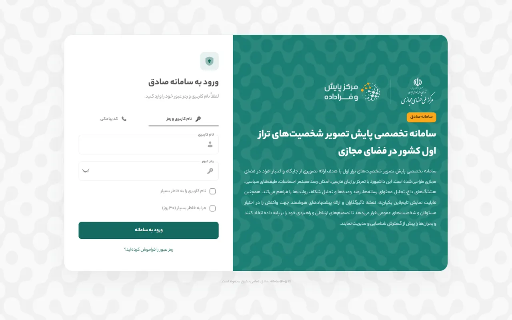

*تصویر: صفحه ورود: برگه «نام کاربری و رمز»*

### گام ۲: ورود با کد پیامکی

برگه **«کد پیامکی»** را انتخاب کنید، **«شماره موبایل»** ثبت‌شده در حساب خود را بنویسید و **«دریافت کد ورود»** را بزنید. کد پیامک‌شده را در **«کد تأیید»** وارد کنید و **«ورود به سامانه»** را بزنید. کد مدت کوتاهی اعتبار دارد؛ اگر منقضی شد، **«ارسال دوباره کد»** را بزنید.

> **نکته:** ورود پیامکی فقط برای حسابی کار می‌کند که مدیر برایش شماره موبایل ثبت کرده باشد.

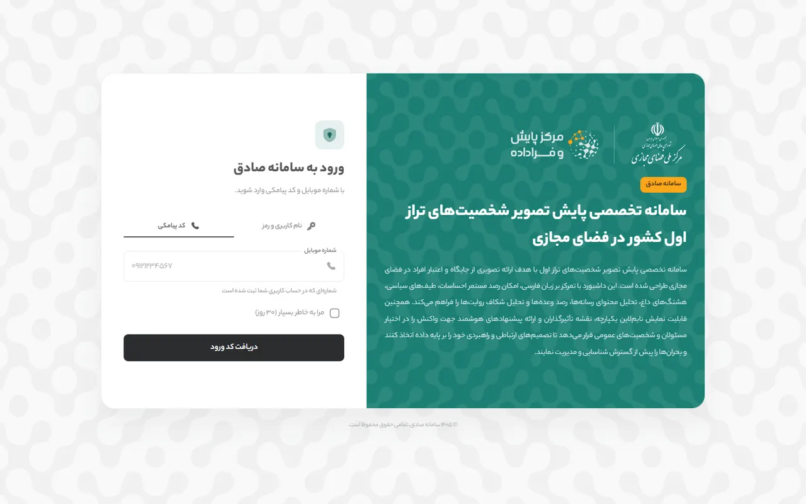

*تصویر: برگه «کد پیامکی»*

### گام ۳: فراموشی رمز عبور

زیر فرم ورود **«رمز عبور را فراموش کرده‌اید؟»** را بزنید. شماره موبایل حساب را وارد کنید و **«ارسال کد بازیابی»** را بزنید، کد را با **«تأیید کد»** تأیید کنید، سپس **«رمز عبور جدید»** و **«تکرار رمز عبور جدید»** (حداقل ۶ کاراکتر) را بنویسید و **«ذخیره رمز عبور جدید»** را بزنید.

> **نکته:** پس از تغییر رمز، ورودهای **«مرا به خاطر بسپار»** روی دستگاه‌های دیگر هم بسته می‌شوند.

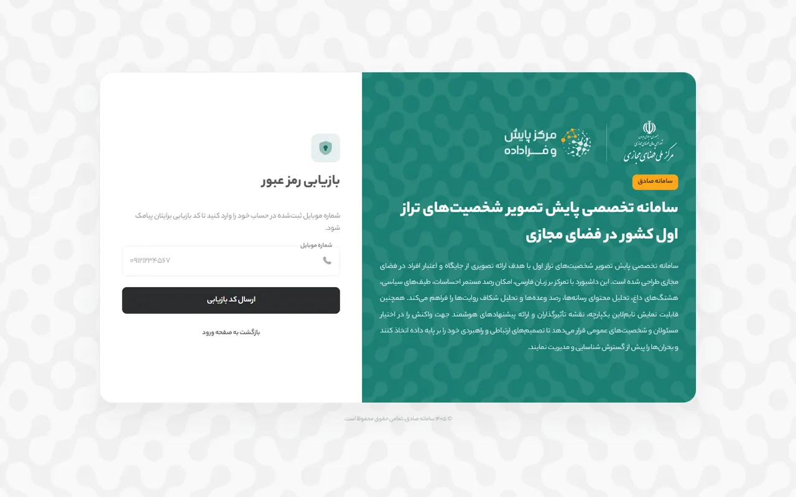

*تصویر: بازیابی رمز عبور با کد پیامکی*

## ۲. آشنایی با صفحه و انتخاب شخصیت

نوار بالای صفحه نام سامانه، زمان آخرین به‌روزرسانی داده‌ها و شخصیتی را که می‌بینید نشان می‌دهد؛ منوی کنار صفحه بخش‌های سامانه را باز می‌کند.

### گام ۱: نوار بالای صفحه

در وسط نوار بالا **«سامانه صادق»** و **«آخرین به‌روزرسانی»** داده‌ها با تاریخ و ساعت دقیق دیده می‌شود. در کنار آن زنگ **«اعلان‌ها»** (خبر پایان جمع‌آوری یا تغییر سطح بحران)، دکمه **«حالت تاریک»** / **«حالت روشن»** و کارت شخصیت در حال مشاهده قرار دارند.

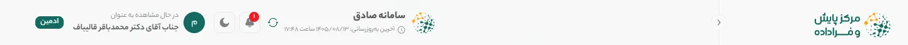

*تصویر: نوار بالای صفحه*

### گام ۲: انتخاب شخصیت

روی کارت شخصیت (**«پروفایل»** یا **«در حال مشاهده به عنوان»**) بزنید تا فهرست شخصیت‌هایی که به آن‌ها دسترسی دارید باز شود. شخصیت‌ها به ترتیب اهمیت سمت مرتب شده‌اند و وقتی تعدادشان زیاد باشد با **«جستجوی پروفایل…»** پیدا می‌شوند. همه بخش‌های داشبورد برای شخصیت انتخاب‌شده نمایش داده می‌شوند.

> **نکته:** اگر فقط به یک شخصیت دسترسی داشته باشید، این کارت فقط نام او را نشان می‌دهد.

### گام ۳: منوی بخش‌ها

از منوی کنار صفحه بخش‌ها را باز کنید: **«داشبورد»**، **«رسانه»**، **«پست‌ها»**، **«تحلیل»**، **«پیشنهادها»**، **«گزارش‌ها»**، **«پروفایل»** و **«راهنما»**. در تلفن همراه همین بخش‌ها در نوار پایین صفحه هستند.

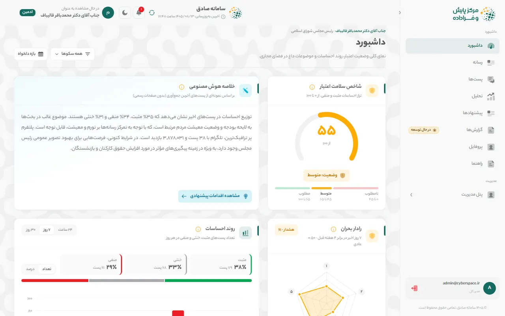

*تصویر: صفحه «داشبورد» با منوی کنار صفحه*

## ۳. فیلتر سکوها و بازه زمانی

دو دکمه زیر عنوان صفحه، داده همه بخش‌ها را به سکوها و بازه دلخواه شما محدود می‌کنند.

### گام ۱: انتخاب سکوها

دکمه **«همه سکوها»** را بزنید و سکوهای دلخواه (مثلاً ایکس، بله و ایتا) را علامت بزنید. از این پس فقط داده همین سکوها در **«داشبورد»**، **«رسانه»**، **«پست‌ها»**، **«تحلیل»** و **«پیشنهادها»** نمایش داده می‌شود. انتخاب شما برای دفعات بعد هم ذخیره می‌شود.

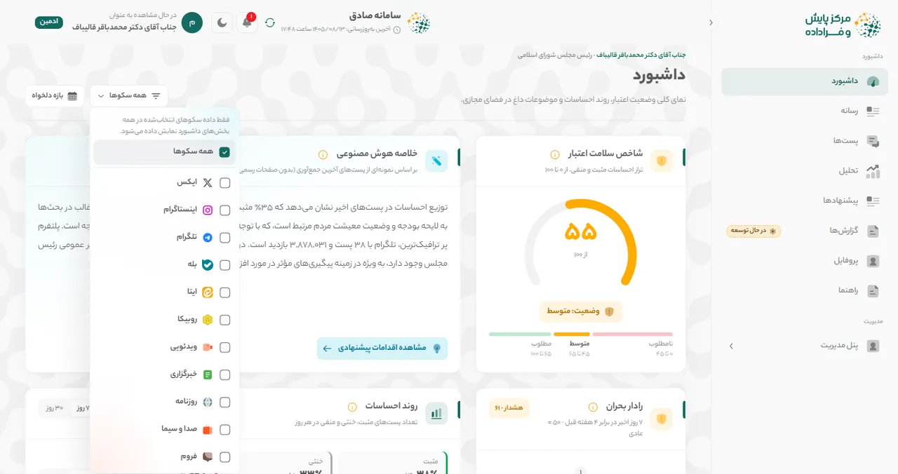

*تصویر: منوی انتخاب سکوها*

### گام ۲: انتخاب بازه زمانی دلخواه

دکمه **«بازه دلخواه»** تقویم شمسی را باز می‌کند. یکی از **«بازه‌های آماده»** (۷، ۱۴، ۳۰ یا ۹۰ روز اخیر، **«ماه جاری»**، **«ماه گذشته»**) را بزنید یا روز شروع و روز پایان را روی تقویم انتخاب کنید و **«اعمال»** را بزنید. بازه حداکثر ۹۰ روز است.

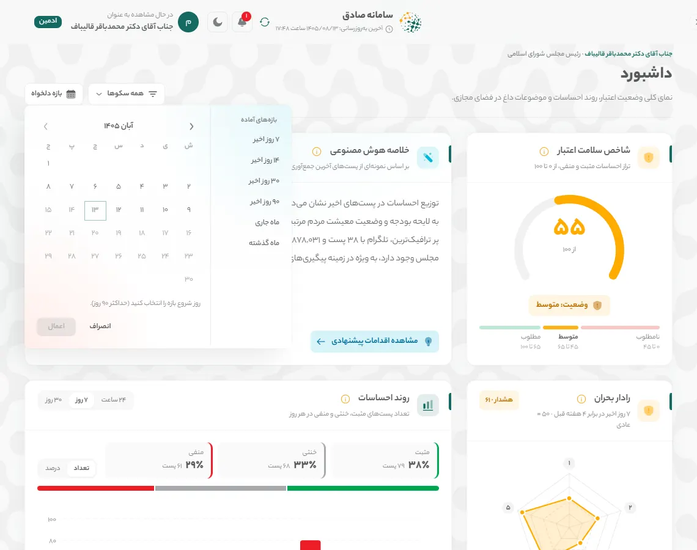

*تصویر: تقویم شمسی «بازه دلخواه»*

### گام ۳: برداشتن فیلترها

وقتی فیلتری فعال است، دکمه **«حذف همه فیلترها»** کنار آن ظاهر می‌شود. در تقویم هم **«حذف بازه»** فقط بازه را برمی‌دارد.

> **نکته:** خلاصه هوش مصنوعی، پیشنهادها و وضعیت کلان کشور همیشه بر اساس همه سکوها و آخرین جمع‌آوری ساخته می‌شوند؛ یادداشت کوچکی زیر این کارت‌ها این را یادآوری می‌کند.

## ۴. خواندن داشبورد و کارت‌ها

هر کارت یک پرسش را پاسخ می‌دهد. با نماد (i) کنار عنوان هر کارت توضیح کامل آن را ببینید.

### گام ۱: توضیح هر کارت

نشانگر را روی نماد (i) کنار عنوان کارت ببرید (در تلفن همراه روی آن بزنید). توضیح در چهار بخش می‌آید: **«چه چیزی را نشان می‌دهد»**، **«نحوه محاسبه»**، **«منبع داده»** و **«بازه زمانی»**.

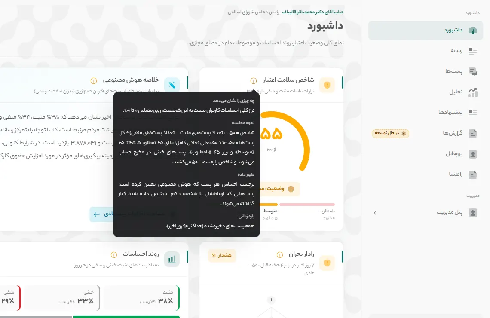

*تصویر: توضیح کارت «شاخص سلامت اعتبار»*

### گام ۲: بازه هر کارت

بسیاری از کارت‌ها دکمه‌های **«۲۴ ساعت»**، **«۷ روز»** و **«۳۰ روز»** دارند. **«روند احساسات»** علاوه بر آن بین **«تعداد»** و **«درصد»** جابه‌جا می‌شود. اگر بالای صفحه بازه دلخواه انتخاب کرده باشید، همین دکمه‌ها تعداد روزهای انتخابی را نشان می‌دهند.

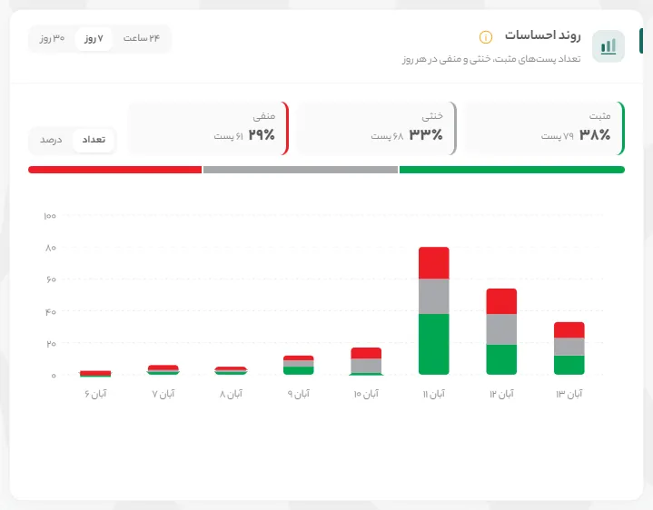

*تصویر: کارت «روند احساسات»*

### گام ۳: طیف سیاسی

کارت **«طیف سیاسی»** نشان می‌دهد پست‌های هر جناح درباره این شخصیت چه سهمی مثبت، خنثی یا منفی است. سه کاشی بالای کارت جمع همه جناح‌هاست.

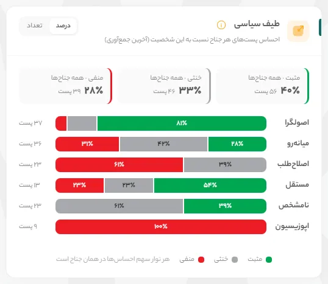

*تصویر: کارت «طیف سیاسی»*

### گام ۴: هشتگ‌ها و ابر هشتگ

کارت **«هشتگ‌ها و موضوعات داغ»** پنج موضوع برتر را نشان می‌دهد؛ **«بیشتر»** بقیه را باز می‌کند. با دکمه ابر (بالای فهرست) نمای **«ابر هشتگ»** را ببینید.

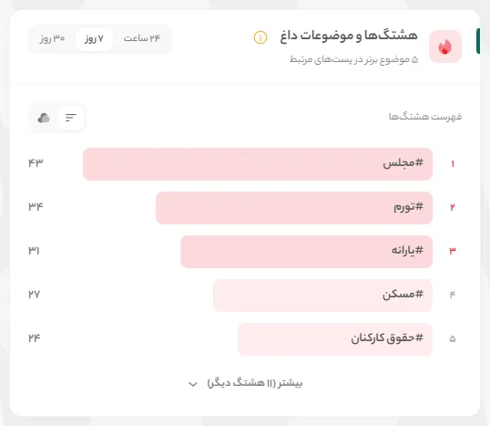

*تصویر: کارت «هشتگ‌ها و موضوعات داغ»*

### گام ۵: رادار بحران

کارت **«رادار بحران»** پنج نشانه بحران را با حالت عادی چهار هفته قبل مقایسه می‌کند. برچسب بالای کارت سطح فعلی است: عادی، **«هشدار»** (از ۵۵) یا **«بحرانی»** (از ۷۰).

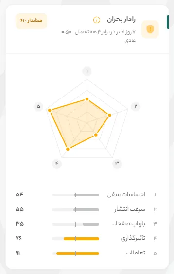

*تصویر: کارت «رادار بحران»*

### گام ۶: صفحه «تحلیل»

در **«تحلیل»** کارت‌های **«وضعیت کلان کشور»** (در چهار حوزه فرهنگی و اجتماعی، سیاسی و دیپلماتیک، امنیتی و نظامی، اقتصادی و معیشتی)، **«ابر واژگان»**، **«حساب‌های ربات و انسانی»** با دلایل مشکوک‌بودن، **«چشم‌انداز عمومی»** و **«تحلیل شکاف روایت»** را می‌بینید.

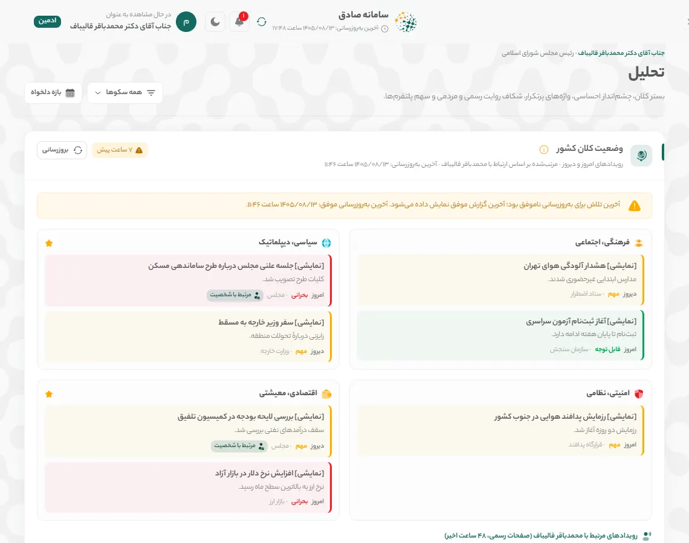

*تصویر: صفحه «تحلیل»*

### گام ۷: وضعیت کلان کشور

رویدادهای مرتبط با سمت شخصیت با برچسب **«مرتبط با شخصیت»** مشخص و اول نمایش داده می‌شوند. اگر به‌روزرسانی ناموفق باشد، آخرین گزارش موفق با هشدار **«به‌روز نیست»** نمایش داده می‌شود.

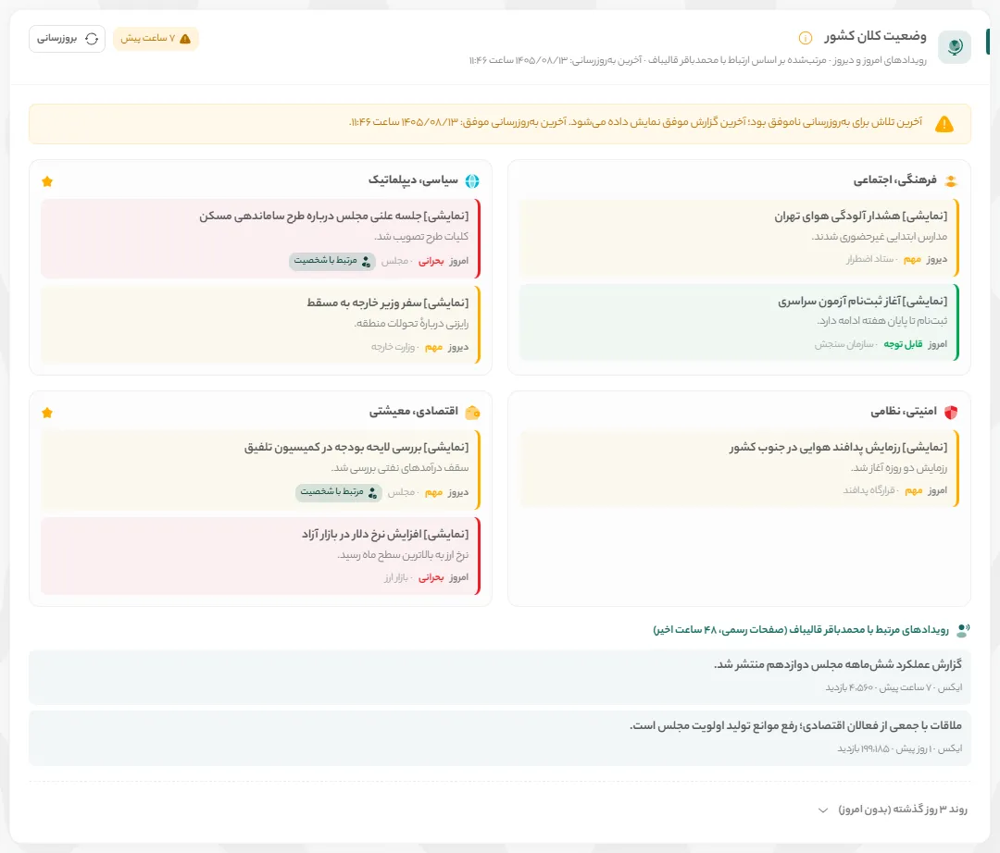

*تصویر: کارت «وضعیت کلان کشور»*

### گام ۸: حساب‌های ربات و انسانی

این کارت سهم حساب‌های **«انسانی»**، **«مشکوک»** و **«احتمالاً ربات»** را نشان می‌دهد و برای هر حساب مشکوک امتیاز، سطح اطمینان و دلایل را می‌آورد. این یک برآورد آماری است، نه تشخیص قطعی.

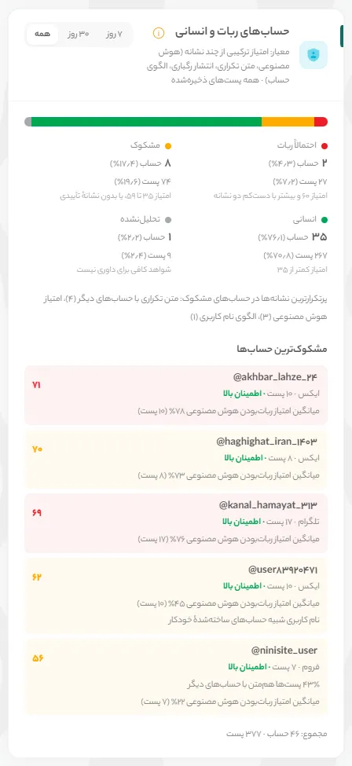

*تصویر: کارت «حساب‌های ربات و انسانی»*

### گام ۹: صفحه «رسانه» و رصد وعده‌ها

در **«رسانه»**، **«صفحات رسمی»** شخصیت، **«رصد وعده‌ها»**، **«تحلیل محتوای منتشرشده»** و **«تایم‌لاین یکپارچه»** قرار دارند. در **«رصد وعده‌ها»** وعده‌های سمت فعلی اول می‌آیند و وعده‌های سمت‌های پیشین جداگانه گروه‌بندی شده‌اند.

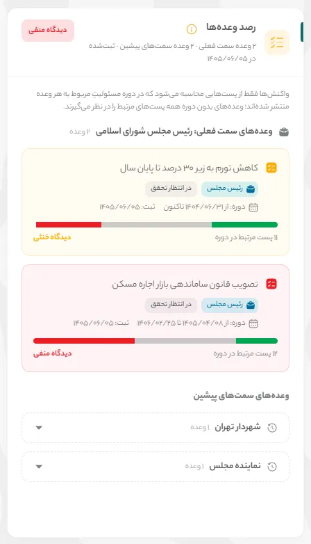

*تصویر: کارت «رصد وعده‌ها»*

### گام ۱۰: صفحه «پست‌ها»

**«خلاصه پلتفرم‌ها»** تعداد پست هر سکو را نشان می‌دهد؛ با زدن هر سکو فهرست‌های پایین صفحه به آن محدود می‌شوند. **«نقشه تأثیرگذاران»**، **«پربازدیدترین پست‌ها»**، **«پربحث‌ترین پست‌ها»** و **«پرتکرارترین پست‌ها»** هم در همین صفحه‌اند.

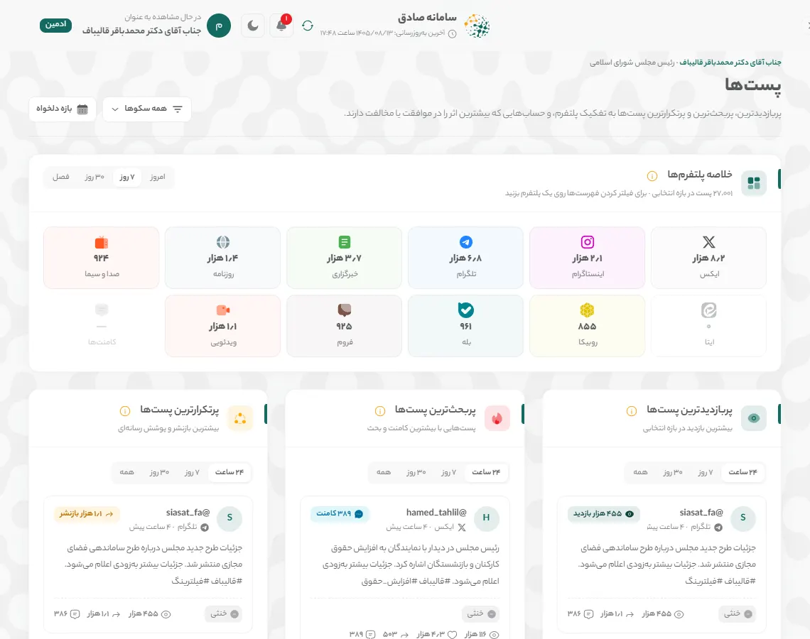

*تصویر: صفحه «پست‌ها»*

### گام ۱۱: صفحه «پیشنهادها»

**«پیشنهادهای امروز»** اقدام‌های پیشنهادی برای واکنش رسانه‌ای را با اولویت نشان می‌دهد. در **«شبیه‌ساز سناریو»** یک اتفاق فرضی بنویسید تا واکنش احتمالی فضای مجازی پیش‌بینی شود؛ این پیش‌بینی است، نه داده واقعی.

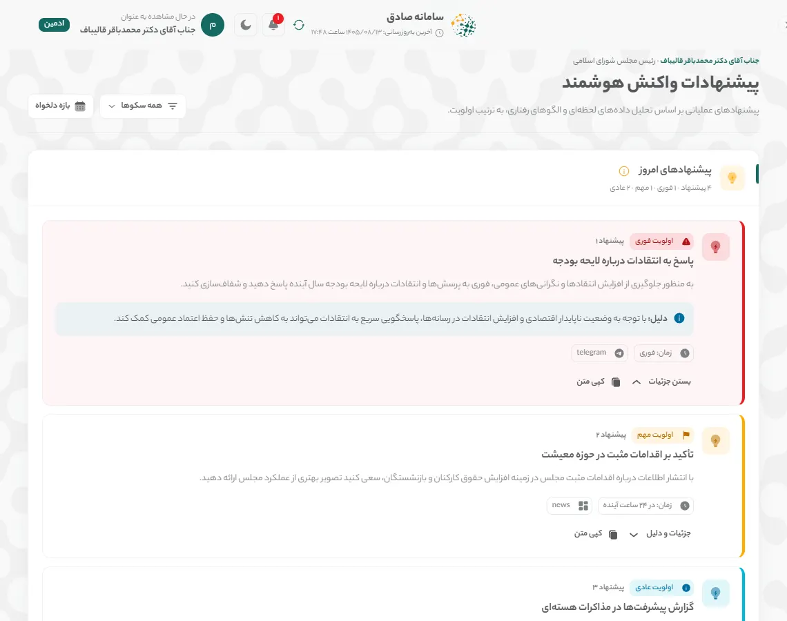

*تصویر: صفحه «پیشنهادات واکنش هوشمند»*

## ۵. دریافت گزارش

در «گزارش‌ها» برای شخصیت انتخاب‌شده گزارش PDF صفحه‌بندی‌شده در قطع A4 بسازید.

### گام ۱: نوع و بازه گزارش

در گام ۱، **«نوع و بازهٔ گزارش»**، یکی از **«روزانه»**، **«هفتگی»**، **«ماهانه»** یا **«بازه دلخواه»** را انتخاب کنید. برای بازه دلخواه **«انتخاب بازه»** را بزنید و تا ۹۰ روز را در تقویم شمسی مشخص کنید.

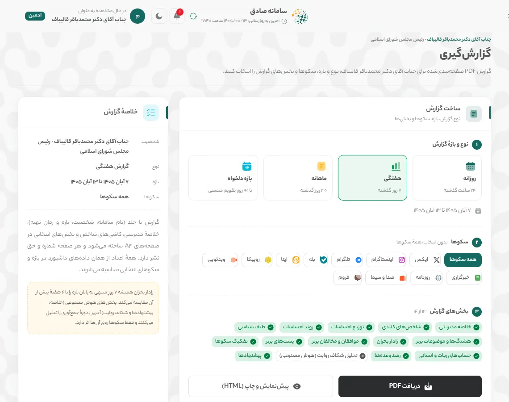

*تصویر: صفحه «گزارش‌گیری»*

### گام ۲: سکوها و بخش‌ها

در گام ۲، **«سکوها»**، سکوهای دلخواه را انتخاب کنید؛ بدون انتخاب، **«همه سکوها»** در گزارش می‌آیند. در گام ۳، **«بخش‌های گزارش»**، بخش‌هایی مانند **«خلاصه مدیریتی»**، **«روند احساسات»**، **«رادار بحران»** یا **«رصد وعده‌ها»** را روشن یا خاموش کنید.

### گام ۳: دریافت PDF یا چاپ

**«دریافت PDF»** فایل گزارش را دانلود می‌کند. **«پیش‌نمایش و چاپ (HTML)»** گزارش را در پنجره‌ای تازه باز می‌کند تا آن را ببینید یا چاپ کنید. کارت **«خلاصهٔ گزارش»** پیش از ساخت، شخصیت، نوع، بازه و سکوها را نشان می‌دهد.

> **نکته:** اگر پیش‌نمایش باز نشد، به مرورگر اجازه باز کردن پنجره جدید را بدهید.

## ۶. حساب کاربری و خروج

رمز عبور خود را از صفحه «پروفایل» تغییر دهید و از پایین منوی کنار صفحه خارج شوید.

### گام ۱: صفحه پروفایل

در **«پروفایل»** مشخصات شخصیت تحت رصد، کلیدواژه‌ها، **«کانال‌ها و صفحات رسمی»** و **«اطلاعات سیستمی»** را می‌بینید.

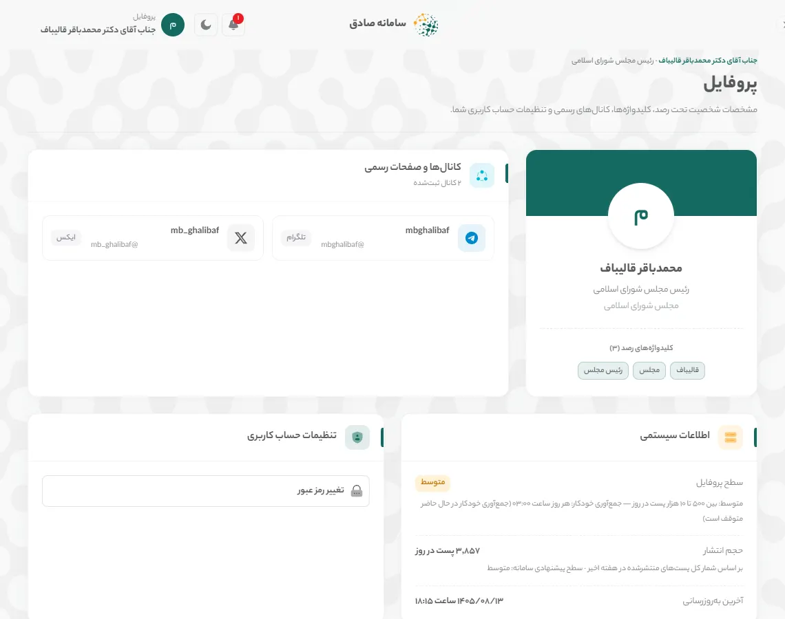

*تصویر: صفحه «پروفایل»*

### گام ۲: تغییر رمز عبور

در کارت **«تنظیمات حساب کاربری»**، **«تغییر رمز عبور»** را بزنید، **«رمز عبور فعلی»**، **«رمز عبور جدید»** و **«تکرار رمز جدید»** را بنویسید و **«ذخیره»** را بزنید. رمز جدید باید حداقل ۶ کاراکتر و با رمز فعلی متفاوت باشد.

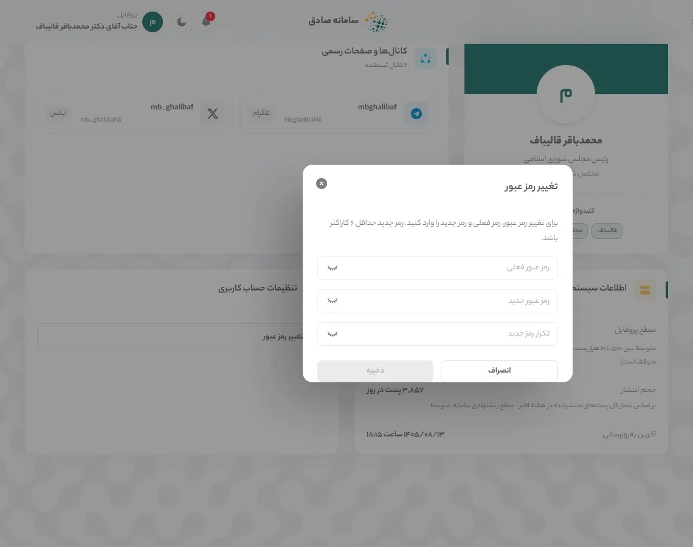

*تصویر: پنجره «تغییر رمز عبور»*

### گام ۳: خروج

در پایین منوی کنار صفحه، کنار نام خود، دکمه **«خروج از حساب»** را بزنید. روی دستگاه‌های مشترک همیشه خارج شوید و **«مرا به خاطر بسپار»** را روشن نکنید.

## واژه‌نامه کارت‌ها

هر کارت داشبورد در یک جمله. توضیح کامل، نحوه محاسبه و منبع داده هر کارت در نماد (i) کنار عنوان آن است.

### صفحه «داشبورد»

- **شاخص سلامت اعتبار:** تراز کلی احساسات کاربران نسبت به این شخصیت، روی مقیاس ۰ تا ۱۰۰.
- **خلاصه هوش مصنوعی:** خلاصه متنی وضعیت فضای مجازی درباره این شخصیت در سه بند کوتاه: وضعیت کلی احساسات، موضوعات و پلتفرم‌های غالب، و مهم‌ترین هشدار یا فرصت.
- **رادار بحران:** پنج نشانه زودهنگام بحران رسانه‌ای: احساسات منفی، سرعت انتشار، بازتاب صفحات رسمی، تأثیرگذاری و تعاملات.
- **روند احساسات:** تعداد پست‌های مثبت، خنثی و منفی در هر روز؛ در نمای ۲۴ ساعت، در هر ساعت.
- **طیف سیاسی:** پست‌های هر جناح سیاسی درباره این شخصیت و اینکه چه سهمی از آن‌ها مثبت، خنثی یا منفی است.
- **هشتگ‌ها و موضوعات داغ:** موضوعات و هشتگ‌هایی که بیشترین تکرار را در پست‌های مرتبط داشته‌اند.
- **پربازدیدترین محتواها:** پست‌هایی درباره این شخصیت که بیشترین بازدید را داشته‌اند.
- **منابع داده:** تعداد پست‌های مرتبط با این شخصیت در هر پلتفرم.

### صفحه «تحلیل»

- **وضعیت کلان کشور:** مهم‌ترین رویدادهای امروز و دیروز کشور در چهار حوزه: فرهنگی و اجتماعی، سیاسی و دیپلماتیک، امنیتی و نظامی، اقتصادی و معیشتی؛ به‌همراه رویدادهای مرتبط با خود شخصیت.
- **چشم‌انداز عمومی:** چشم‌انداز عمومی: سهم هر حالت احساسی (امید، نگرانی، اطمینان و …) در پست‌های مرتبط.
- **ابر واژگان:** کلیدواژه‌های پرتکرار در گفتگوها درباره این شخصیت؛ هرچه واژه بزرگ‌تر، پرتکرارتر.
- **حساب‌های ربات و انسانی:** چه سهمی از حساب‌هایی که درباره این شخصیت نوشته‌اند احتمالاً ربات یا مشکوک‌اند، و مشکوک‌ترین حساب‌ها کدام‌اند.
- **تحلیل شکاف روایت:** چه سهمی از بحث مردم به روایت‌هایی می‌پردازد که شخصیت در صفحات رسمی‌اش مطرح می‌کند، و مردم خارج از این روایت‌ها درباره چه موضوعاتی می‌نویسند.

### صفحه «رسانه»

- **صفحات رسمی:** کانال‌ها و صفحات رسمی این شخصیت که در سامانه پایش می‌شوند.
- **رصد وعده‌ها:** وعده‌های ثبت‌شده این شخصیت، سمت و دوره مسئولیتی که وعده در آن داده شده، و واکنش مردم به هر کدام.
- **تحلیل محتوای منتشرشده:** حجم، بازدید، لایک و بازنشر محتوای منتشرشده در صفحات رسمی، هفته به هفته.
- **تایم‌لاین یکپارچه:** آخرین پست‌های منتشرشده در صفحات رسمی، به ترتیب زمان.

### صفحه «پست‌ها»

- **خلاصه پلتفرم‌ها:** تعداد کل پست‌هایی که در هر پلتفرم درباره این شخصیت منتشر شده است.
- **نقشه تأثیرگذاران:** حساب‌هایی که بیشترین بازدید را در گفتگو درباره این شخصیت داشته‌اند و موضعشان.
- **پربازدیدترین پست‌ها:** پست‌هایی با بیشترین تعداد بازدید.
- **پربحث‌ترین پست‌ها:** پست‌هایی که بیشترین بحث و نظر را برانگیخته‌اند.
- **پرتکرارترین پست‌ها:** پست‌هایی که بیشتر از بقیه بازنشر یا فوروارد شده‌اند.

### صفحه «پیشنهادها»

- **پیشنهادهای امروز:** پیشنهادهای عملیاتی برای واکنش رسانه‌ای.
- **شبیه‌ساز سناریو:** شبیه‌ساز سناریو: یک اتفاق فرضی بنویسید تا واکنش احتمالی فضای مجازی پیش‌بینی شود.

## پرسش‌های پرتکرار

**چرا عددهای یک کارت با کارت دیگر کمی فرق دارد؟**

هر کارت بازه و مجموعه پست خودش را دارد؛ مثلاً **«منابع داده»** همه پست‌های منطبق با کلیدواژه‌ها را می‌شمارد ولی **«روند احساسات»** فقط پست‌های ذخیره‌شده و تحلیل‌شده را. توضیح (i) هر کارت بازه و منبع آن را می‌گوید.

**داده‌ها هر چند وقت به‌روز می‌شوند؟**

بسته به حجم پست‌های هر شخصیت، از چند بار در روز تا هر چند روز یک بار. زمان دقیق آخرین به‌روزرسانی در وسط نوار بالای صفحه آمده است.

**فیلتر سکوها روی خلاصه هوش مصنوعی اثر ندارد؟**

خیر. **«خلاصه هوش مصنوعی»**، **«پیشنهادهای امروز»** و **«وضعیت کلان کشور»** همیشه از همه سکوها و آخرین جمع‌آوری ساخته می‌شوند و یادداشت زیر کارت این را می‌گوید. **«تحلیل شکاف روایت»** برای سکوها و بازه انتخابی دوباره شمرده می‌شود.

**کد پیامکی به دستم نمی‌رسد.**

مطمئن شوید شماره را درست و با همان شماره‌ای که در حساب شما ثبت شده وارد کرده‌اید. اگر شماره‌ای ثبت نشده، از مدیر بخواهید آن را در **«کاربران و نقش‌ها»** اضافه کند. پس از پایان شمارش معکوس، **«ارسال دوباره کد»** را بزنید.

**شخصیت مورد نظرم را در فهرست نمی‌بینم.**

فقط شخصیت‌هایی نمایش داده می‌شوند که مدیر در **«دسترسی به شخصیت‌ها»** به شما داده است. از مدیر سامانه بخواهید دسترسی را اضافه کند.

**چطور حالت تاریک را روشن کنم؟**

دکمه ماه (**«حالت تاریک»**) در نوار بالای صفحه را بزنید. با دوباره زدن آن (**«حالت روشن»**) به حالت روشن برمی‌گردید.

---

© حقوق مادی و معنوی سامانه صادق و این راهنما محفوظ است. هرگونه تکثیر، انتشار یا استفاده تجاری از محتوا و تصاویر این راهنما بدون مجوز کتبی، مطابق «قانون حمایت از حقوق مؤلفان و مصنفان و هنرمندان» ممنوع و پیگرد قانونی دارد.

© ۱۴۰۵ سامانه صادق، تمامی حقوق محفوظ است.

